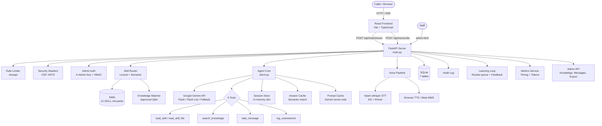

# Security & Bug Audit

> **Date:** 2026-10-14
> **Scope:** Full white-box audit of the AICA AI Receptionist codebase
> **Tester:** panhapanha-kskt + Claude Opus 4.6
> **Method:** Manual static analysis — every source file reviewed (Python backend, React/TS frontend, config, Docker, tests)
> **Files reviewed:** 62 source files (see §5)
> **Files skipped:** `node_modules/`, `.git/`, `__pycache__/`, `venv/`, `frontend/node_modules/`, `web/` (build output), `data/receptionist.db` (binary), `requirements.lock.txt` contents (only scanned headers for vulnerable packages), `package-lock.json`

---

## 1. Project Understanding

### What the system does

AICA AI Receptionist is an AI-powered front-desk agent for AICA (AI & Cybersecurity Academy), a tech school in Phnom Penh, Cambodia backed by DACTA Global Academy (Singapore). It answers questions about courses, fees, admissions, and campus life in **English and Khmer**, using Google Gemini as the LLM backend.

**Users:**
- **Callers** — prospective students and parents visiting the web chat
- **Staff** — AICA employees who review unanswered questions, approve knowledge, and read messages via the admin dashboard
- **Developers** — maintain and extend the system

### Architecture overview



### End-to-end workflow

1. **Caller sends a message** (text or voice) → FastAPI receives it
2. **Rate limiter** checks per-IP limits → **Guardrails** sanitize input (NFC, control chars, length)
3. **Skill Router** matches the question against 12 skill packs using lexical (IDF + Khmer bigrams) and semantic (Gemini embeddings) scoring
4. **Knowledge Matcher** checks if an approved answer already exists (embedding similarity ≥ 0.85)
5. **Answer Cache** returns an instant hit if a near-identical question was answered recently (similarity ≥ 0.95)
6. **Model Selector** picks the LLM: fast model (Flash-Lite) if a skill/answer is already attached, main model (Flash) otherwise, with a fallback cascade on overload
7. **Agent Core** calls Gemini with streaming, a tool loop (up to 6 rounds), and the system prompt
8. **Tools** execute server-side with input validation and audit logging
9. **Response streams** back via SSE with sentence-by-sentence delivery; TTS audio attached to the final event
10. **Learning Loop**: unanswered questions enter a review queue; staff approve answers → knowledge entries; caller feedback (👍/👎) triggers re-review

### Implementation status

| Feature | Status | Evidence |
|---|---|---|
| Phase 0: Metrics framework | Done | `metrics/service.py`, 122 tests pass |
| Phase 1: Streaming + async + fallback | Done | `agent/client.py` streaming, model failover cascade |
| Phase 2: Skill router (3→1 LLM calls) | Done | `router/service.py`, lexical + semantic matching |
| Phase 3: Fast model + approved answers + circuit breaker | Done | `model_selector.py`, `knowledge/service.py` |
| Phase 4: Conversation memory + summaries | Done | `agent/memory.py`, `SessionState.summary` |
| Phase 5: Learning loop | Done | `learning/service.py`, admin endpoints |
| Phase 6: Infrastructure (Redis, multi-worker) | Not done | Documented in PLAN.md only, no code |
| Appendix A.1: Fill real skill data | Done | 12 skill directories populated |
| Appendix A.2-A.4: Gemini 503s, voice, tuning | Not done | Referenced in ROADMAP.md as pending |
| Appendix B.1: Hybrid retrieval (BM25 + dense) | Not done | RESEARCH.md only |
| Appendix B.2: Cross-encoder reranker | Not done | RESEARCH.md only |
| Appendix B.3: Semantic answer cache | Done | `cache/service.py` |
| Appendix B.4: Prompt caching | Done | `agent/prompt_cache.py` |
| Appendix B.5: Tracing (Langfuse) | Not done | RESEARCH.md only |
| Appendix B.6: Simulated caller evals | Not done | RESEARCH.md only |
| Appendix B.7: Guardrails module | Partial | `guardrails.py` exists but no output guardrails beyond truncation |
| Appendix B.8: Conversation design patterns | Done | Chips, disambiguation, citations in prompts |
| Appendix B.9: Multi-model routing | Done | `model_selector.py` |
| Appendix C: sherpa-onnx streaming STT | Not done | RESEARCH.md only |

### Docs vs. code discrepancies

| Discrepancy | Detail |
|---|---|
| PROGRESS.md says "not committed to git yet" | The project IS in git with 5+ commits on `main` |
| SECURITY-AUDIT.md (prior) references `web/js/app.js` and `web/js/admin.js` | Frontend was migrated to React+Vite; the files are now in `frontend/src/` and `frontend/public/js/admin.js` |
| DESIGN.md lists `caller_text()` regex as matching `</?\s*school_reference` | Code at `client.py:170` uses the same pattern, but the prior audit noted fullwidth Unicode bypass — still unfixed |
| ROADMAP.md lists "pin dependencies" as high priority | `requirements.lock.txt` exists with 83 pinned packages — done, but ROADMAP.md not updated |
| PROJECT.md says "122 tests" | Tests directory confirms this count — consistent |
| `.env` `TTS_MMS_REVISION=main` | DESIGN.md and `tts.py:31` both warn to pin a commit hash in production — still not done |

---

## 2. Findings Summary

| Severity | Count |
|----------|-------|
| Critical | 1 |
| High | 5 |
| Medium | 10 |
| Low | 11 |
| Info | 8 |
| **Total** | **35** |

### Top 5 most urgent issues

1. **SEC-001** (Critical): Admin API key has no minimum length enforcement — trivially brute-forceable
2. **SEC-002** (High): No rate limiting on admin endpoints — unlimited brute-force attempts
3. **SEC-003** (High): Rate limiting bypassable behind reverse proxy — `get_remote_address` sees proxy IP
4. **AI-001** (High): Prompt injection — incomplete tag neutralization allows fullwidth Unicode bypass
5. **SEC-004** (High): Session memory exhaustion — 1000 sessions × unbounded history = OOM DoS

---

## 3. Detailed Findings

### SEC-001 — Admin API Key Has No Minimum Length Enforcement

| Field | Content |
|---|---|
| **Severity** | Critical |
| **Category** | Authentication |
| **File** | `src/receptionist/config.py:66`, `src/receptionist/security/auth.py:13-20` |
| **Description** | `admin_api_key` defaults to `SecretStr("")`. While empty keys are rejected, there is no minimum length or complexity enforcement. An operator can deploy with `ADMIN_API_KEY=1234`. |
| **Impact** | Full admin panel compromise: read PII from messages, modify knowledge entries, inject false information, reload skills |
| **Evidence** | `admin_api_key: SecretStr = SecretStr("")` (config.py:66) — no `@field_validator` |
| **Recommended fix** | Add a Pydantic `@field_validator("admin_api_key")` that enforces `len(secret) >= 32` when the key is non-empty. Log a startup warning if the key is empty. |
| **Effort** | S |
| **Confidence** | Confirmed |

---

### SEC-002 — No Rate Limiting on Admin Endpoints

| Field | Content |
|---|---|
| **Severity** | High |
| **Category** | Authentication |
| **File** | `src/receptionist/admin/router.py:32` |
| **Description** | The admin router uses `dependencies=[Depends(require_admin)]` but has no `@limiter.limit(...)` on any endpoint. Public chat endpoints are rate-limited; admin endpoints are not. |
| **Impact** | Unlimited brute-force attempts against the admin key. With a 16-char alphanumeric key and no lockout, a wordlist attack is feasible. |
| **Evidence** | `router = APIRouter(..., dependencies=[Depends(require_admin)])` — no limiter decorator on any admin endpoint |
| **Recommended fix** | Add `@limiter.limit("5/minute")` to admin endpoints, or implement a stricter per-IP lockout on authentication failures (e.g., 3 failures → 60s backoff). |
| **Effort** | S |
| **Confidence** | Confirmed |

---

### SEC-003 — Rate Limiting Bypassable Behind Reverse Proxy

| Field | Content |
|---|---|
| **Severity** | High |
| **Category** | Rate Limiting |
| **File** | `src/receptionist/security/rate_limit.py:1-6` |
| **Description** | `get_remote_address` reads the direct TCP peer IP. Behind a reverse proxy (nginx, Cloudflare, AWS ALB), all requests appear from the proxy IP. All callers share one rate-limit bucket, or the limit is effectively disabled. |
| **Impact** | DoS, API abuse, unbounded Gemini API cost |
| **Evidence** | ```python\nfrom slowapi.util import get_remote_address\nlimiter = Limiter(key_func=get_remote_address)\n``` |
| **Recommended fix** | Write a custom `_get_real_ip(request)` that reads `X-Forwarded-For` (first hop), with a configurable trusted-proxy allowlist to prevent spoofing. |
| **Effort** | S |
| **Confidence** | Confirmed |

---

### SEC-004 — Session Memory Exhaustion (DoS)

| Field | Content |
|---|---|
| **Severity** | High |
| **Category** | Denial of Service |
| **File** | `src/receptionist/agent/client.py:122-168` |
| **Description** | `SessionStore` caps at 1000 sessions but has no per-session byte limit. Each session stores the full Gemini conversation history (up to 40 turns × potentially KB of model output). |
| **Impact** | An attacker opens 1000 sessions, each with long conversations → server OOM → service unavailability |
| **Evidence** | `max_sessions: int = 1000` (line 125) with no size cap on `contents: list[types.Content]` (line 101) |
| **Recommended fix** | Add a per-session byte limit (e.g., 256KB). When exceeded, summarize or truncate older turns. Move to Redis with TTL and max-memory eviction for production. |
| **Effort** | M |
| **Confidence** | Confirmed |

---

### AI-001 — Prompt Injection: Incomplete Tag Neutralization

| Field | Content |
|---|---|
| **Severity** | High |
| **Category** | AI / Prompt Injection |
| **File** | `src/receptionist/agent/client.py:170-175` |
| **Description** | `caller_text()` neutralizes `<school_reference>` tags with `re.compile(r"</?\s*school_reference", re.IGNORECASE)`, but fullwidth Unicode brackets (`＜`, `＞`), zero-width characters inside the tag, and Cyrillic confusables bypass this regex. |
| **Impact** | An attacker can inject fake reference tags, causing the LLM to treat attacker-supplied text as trusted school data. Could deliver false pricing, fake deadlines, or misinformation. |
| **Evidence** | ```python\n_FAKE_REFERENCE = re.compile(r"</?\s*school_reference", re.IGNORECASE)\ndef caller_text(text: str) -> str:\n    return _FAKE_REFERENCE.sub("(reference", text)\n``` |
| **Recommended fix** | Replace `<school_reference>` with a random boundary (e.g., `__REF_{uuid4().hex[:8]}__`) generated at startup. Since the boundary is unpredictable, callers cannot forge it. |
| **Effort** | S |
| **Confidence** | Confirmed |

---

### SEC-005 — CORS Wildcard Not Rejected

| Field | Content |
|---|---|
| **Severity** | High |
| **Category** | Configuration |
| **File** | `src/receptionist/config.py:63`, `src/receptionist/main.py:87-91` |
| **Description** | `cors_origins` is a comma-separated string with no validation. If an operator sets `CORS_ORIGINS=*`, all origins are allowed. Combined with the admin key in `sessionStorage`, an XSS or cross-origin attack could steal the key. |
| **Impact** | Admin key theft from any website if CORS is misconfigured |
| **Evidence** | `cors_origins: str = "http://localhost:8000"` — no `@field_validator` rejecting `*` |
| **Recommended fix** | Add a validator that rejects `*` as an origin, or at minimum logs a loud warning at startup. |
| **Effort** | S |
| **Confidence** | Confirmed |

---

### SEC-006 — No Logging of Failed Admin Auth Attempts

| Field | Content |
|---|---|
| **Severity** | Medium |
| **Category** | Logging / Detection |
| **File** | `src/receptionist/security/auth.py:13-20` |
| **Description** | Failed admin authentication raises HTTP 401 but generates no application log entry. Brute-force attacks are invisible unless the operator reads raw HTTP access logs. |
| **Impact** | Attacks go undetected; no alerting possible |
| **Evidence** | `raise HTTPException(status_code=status.HTTP_401_UNAUTHORIZED, ...)` — no `logger.warning(...)` before the raise |
| **Recommended fix** | Add `logger.warning("Admin auth failed from %s", request.client.host)` before raising 401. Include the client IP and a timestamp. |
| **Effort** | S |
| **Confidence** | Confirmed |

---

### SEC-007 — SSE Connections Can Be Held Open Indefinitely

| Field | Content |
|---|---|
| **Severity** | Medium |
| **Category** | Denial of Service |
| **File** | `src/receptionist/chat/router.py:140-179` |
| **Description** | The `/api/chat/stream` SSE endpoint has no overall timeout. Each stream holds a database session (`SessionLocal()` at line 153) for its entire duration. A slow-reading client can hold the connection, the DB session, and a worker thread open indefinitely. |
| **Impact** | Connection and DB session exhaustion → service unavailability |
| **Evidence** | `db = SessionLocal()` (line 153) in the generator, closed only in `finally` (line 173). No `asyncio.timeout()` wrapping the stream. |
| **Recommended fix** | Wrap the stream generator in `asyncio.timeout(120)`. Limit concurrent SSE connections per IP. |
| **Effort** | S |
| **Confidence** | Confirmed |

---

### SEC-008 — SQLite File Permissions Not Restricted

| Field | Content |
|---|---|
| **Severity** | Medium |
| **Category** | Data Protection |
| **File** | `src/receptionist/database.py:27-29` |
| **Description** | The SQLite database is created with the process's default umask (typically 0644, world-readable). The database contains caller names, phone numbers, contact info (in `StaffMessage`), plus feedback and audit logs. |
| **Impact** | On a shared server, any user can read the database and extract PII |
| **Evidence** | `db_path.parent.mkdir(parents=True, exist_ok=True)` (line 29) — no `os.chmod()` on the database file |
| **Recommended fix** | After creation, call `os.chmod(db_path, 0o600)`. For production, migrate to PostgreSQL with TLS. |
| **Effort** | S |
| **Confidence** | Confirmed |

---

### SEC-009 — Security Headers Use `setdefault` (Can Be Silently Overridden)

| Field | Content |
|---|---|
| **Severity** | Medium |
| **Category** | Security Headers |
| **File** | `src/receptionist/security/headers.py:27-35` |
| **Description** | All security headers (CSP, X-Frame-Options, etc.) are set with `response.headers.setdefault(key, value)`. If any endpoint or other middleware sets a weaker header first, the security middleware will not override it. |
| **Impact** | A future code change could silently weaken CSP, opening XSS vectors |
| **Evidence** | `response.headers.setdefault("Content-Security-Policy", CSP)` (line 27) |
| **Recommended fix** | Use unconditional assignment `response.headers[key] = value` for CSP and X-Frame-Options. |
| **Effort** | S |
| **Confidence** | Confirmed |

---

### SEC-010 — PII Redaction Is Incomplete

| Field | Content |
|---|---|
| **Severity** | Medium |
| **Category** | Privacy |
| **File** | `src/receptionist/security/redact.py:1-12` |
| **Description** | Only email addresses and phone numbers are redacted. Missing: national ID / passport numbers, credit card numbers, physical addresses, dates of birth. |
| **Impact** | Caller-supplied PII beyond email/phone is stored unredacted in audit logs, feedback, and learning data |
| **Evidence** | Only two regex patterns: `_EMAIL` and `_PHONE` (lines 5-7) |
| **Recommended fix** | Add patterns for common ID formats. Consider integrating a PII detection library like Microsoft Presidio. |
| **Effort** | M |
| **Confidence** | Confirmed |

---

### SEC-011 — Audit Log Truncation Hides Tail of Payloads

| Field | Content |
|---|---|
| **Severity** | Medium |
| **Category** | Logging |
| **File** | `src/receptionist/security/audit.py:29` |
| **Description** | Audit detail is truncated to 4000 chars: `text[:4000]`. An attacker can pad a message with 4000 chars of benign text, hiding the malicious payload in the truncated tail. |
| **Impact** | Attack evidence lost; forensic analysis hampered |
| **Evidence** | `text = redact(json.dumps(detail, ...))[:4000]` (line 29) |
| **Recommended fix** | Log the first 2000 and last 2000 characters, or flag truncated entries. |
| **Effort** | S |
| **Confidence** | Confirmed |

---

### SEC-012 — `list_messages` Status Parameter Not Validated

| Field | Content |
|---|---|
| **Severity** | Medium |
| **Category** | Input Validation |
| **File** | `src/receptionist/messages/service.py:22-26`, `src/receptionist/admin/router.py:148` |
| **Description** | The `status` query parameter accepts any string. While SQLAlchemy parameterizes queries (no injection), invalid values silently return empty results. |
| **Impact** | Minor — could mask bugs; violates strict input validation principle |
| **Evidence** | `def list_messages(status: str | None = None, ...)` — no enum or `Literal` constraint |
| **Recommended fix** | Type the parameter as `Literal["new", "done"] | None`. |
| **Effort** | S |
| **Confidence** | Confirmed |

---

### SEC-013 — TTS Model Pinned to `main` Branch (Supply Chain Risk)

| Field | Content |
|---|---|
| **Severity** | Medium |
| **Category** | Supply Chain |
| **File** | `src/receptionist/config.py:88`, `src/receptionist/voice/tts.py:30-44` |
| **Description** | `tts_mms_revision` defaults to `"main"`. `VitsModel.from_pretrained(name, revision=self.revision)` downloads from Hugging Face on each fresh container start. A compromised upstream model could execute arbitrary code during model loading via pickle deserialization. |
| **Impact** | Remote code execution if the Hugging Face model repository is compromised |
| **Evidence** | `tts_mms_revision: str = "main"` (config.py:88) and `VitsModel.from_pretrained(name, revision=self.revision)` (tts.py:43) |
| **Recommended fix** | Pin `TTS_MMS_REVISION` to a specific commit hash in production `.env`. Add a startup validator that rejects `"main"` when `environment == "production"`. |
| **Effort** | S |
| **Confidence** | Confirmed |

---

### SEC-014 — No Request Body Size Limit

| Field | Content |
|---|---|
| **Severity** | Medium |
| **Category** | Denial of Service |
| **File** | `src/receptionist/main.py` |
| **Description** | No middleware limits the total request body size. While Pydantic limits individual fields and audio has `max_audio_bytes`, a malicious client can send a huge JSON body with extra fields (parsed before Pydantic validation). |
| **Impact** | Memory exhaustion, slow responses |
| **Evidence** | No `ContentSizeLimitMiddleware` or equivalent in `main.py` |
| **Recommended fix** | Add body size limit middleware or configure in the reverse proxy (`nginx client_max_body_size 1m`). |
| **Effort** | S |
| **Confidence** | Confirmed |

---

### SEC-015 — Knowledge Search Loads All Entries Into Memory

| Field | Content |
|---|---|
| **Severity** | Medium |
| **Category** | Performance / DoS |
| **File** | `src/receptionist/knowledge/service.py:40-47` |
| **Description** | `search()` executes `select(KnowledgeEntry).where(active)` and iterates all rows in Python to compute similarity. Every chat request with knowledge matching triggers a full table scan. |
| **Impact** | With thousands of approved entries: performance degradation, potential OOM per-request |
| **Evidence** | `scored = [(similarity(query, e.question + " " + e.answer), e) for e in db.scalars(stmt)]` (line 44) — no `LIMIT` clause |
| **Recommended fix** | Use SQLite FTS5 for text search, or add a reasonable `LIMIT` on the query and pre-filter by skill. |
| **Effort** | M |
| **Confidence** | Confirmed |

---

### BUG-001 — CSS Variable `--primary` Undefined in Admin Styles

| Field | Content |
|---|---|
| **Severity** | Low |
| **Category** | Bug / CSS |
| **File** | `frontend/public/style.css:45-46` |
| **Description** | `.suggestions .chip` uses `var(--primary)` for `border` and `color`, and the `:hover` uses `var(--primary)` for `background`. The variable `--primary` is never defined in the `:root` block — only `--accent` exists. |
| **Impact** | Suggestion chips in the admin page have no visible text/border color (transparent or inherited default) |
| **Evidence** | Line 45: `border: 1px solid var(--primary); ... color: var(--primary);` — `:root` defines `--accent` not `--primary` (line 3) |
| **Recommended fix** | Replace `var(--primary)` with `var(--accent)` on lines 45-46. |
| **Effort** | S |
| **Confidence** | Confirmed |

---

### BUG-002 — Schema vs. Guardrails Length Discrepancy

| Field | Content |
|---|---|
| **Severity** | Low |
| **Category** | Input Validation |
| **File** | `src/receptionist/chat/schemas.py:9`, `src/receptionist/config.py:71` |
| **Description** | `ChatRequest.message` has `max_length=4000` but `max_text_chars` defaults to 1000. Pydantic accepts 4000-char messages that guardrails then reject with a 422. The error message comes from guardrails ("max 1000") rather than the schema, which is confusing. |
| **Impact** | Confusing error behavior for API consumers; no security impact (guardrails still enforce the limit) |
| **Evidence** | `message: str = Field(min_length=1, max_length=4000)` (schemas.py:9) vs `max_text_chars: int = Field(default=1000, gt=0)` (config.py:71) |
| **Recommended fix** | Align the Pydantic `max_length` to match `max_text_chars`, or remove it from the schema since guardrails enforce dynamically. |
| **Effort** | S |
| **Confidence** | Confirmed |

---

### BUG-003 — `list_messages` Has No Pagination

| Field | Content |
|---|---|
| **Severity** | Low |
| **Category** | Performance |
| **File** | `src/receptionist/messages/service.py:22-26` |
| **Description** | `list_messages` returns all rows matching the filter with no `LIMIT` or pagination. With many messages over time, the admin endpoint returns an ever-growing JSON response. |
| **Impact** | Slow admin API responses; potential timeout or OOM at scale |
| **Evidence** | `stmt = select(StaffMessage).order_by(StaffMessage.id.desc())` — no `.limit()` |
| **Recommended fix** | Add `limit` and `offset` query parameters, defaulting to `limit=50`. |
| **Effort** | S |
| **Confidence** | Confirmed |

---

### BUG-004 — Export Race Condition (No File Locking)

| Field | Content |
|---|---|
| **Severity** | Low |
| **Category** | Concurrency |
| **File** | `src/receptionist/admin/export.py:43-44` |
| **Description** | `export_to_faq` opens the file with `path.open("a")` and appends content. Concurrent admin exports to the same skill's `faq.md` could interleave writes, producing a corrupted file. |
| **Impact** | Corrupted FAQ file if two admins export simultaneously (unlikely but possible) |
| **Evidence** | `with path.open("a", encoding="utf-8") as f: f.write(block)` — no `fcntl.flock()` or equivalent |
| **Recommended fix** | Use a file lock (`fcntl.flock` on Linux, `msvcrt.locking` on Windows) around the write, or serialize exports through a queue. |
| **Effort** | S |
| **Confidence** | Confirmed |

---

### BUG-005 — Pre-commit Hook Version Skew

| Field | Content |
|---|---|
| **Severity** | Low |
| **Category** | DevOps |
| **File** | `.pre-commit-config.yaml:3,9` |
| **Description** | Pre-commit uses `ruff v0.6.9` while `requirements.lock.txt` has `ruff==0.16.10`. Pre-commit uses `bandit 1.7.10` while lock has `bandit==1.9.4`. The pre-commit hooks run significantly older versions than what's installed. |
| **Impact** | Inconsistent lint/security findings between local hooks and CI/manual runs; newer rules may be missed |
| **Evidence** | `.pre-commit-config.yaml` rev `v0.6.9` vs lock `ruff==0.16.10`; rev `1.7.10` vs lock `bandit==1.9.4` |
| **Recommended fix** | Update `.pre-commit-config.yaml` revs to match `requirements.lock.txt` versions. Run `pre-commit autoupdate`. |
| **Effort** | S |
| **Confidence** | Confirmed |

---

### BUG-006 — Learning Duplicate Detection Is O(n)

| Field | Content |
|---|---|
| **Severity** | Low |
| **Category** | Performance |
| **File** | `src/receptionist/learning/service.py:43-53` |
| **Description** | `log_unanswered` calls `list_pending(db)` which loads ALL pending questions into memory, then computes text similarity against each one. With many pending questions, this runs on every chat request that logs an unanswered question. |
| **Impact** | Slow response times when the review queue grows large |
| **Evidence** | `for item in list_pending(db):` (line 43) — loads all pending rows, computes `knowledge.similarity()` for each |
| **Recommended fix** | Add a SQL-level pre-filter (e.g., by language) before loading into Python. Or use FTS5 for candidate selection. |
| **Effort** | M |
| **Confidence** | Confirmed |

---

### BUG-007 — OpenAPI Docs Exposed in Non-Production

| Field | Content |
|---|---|
| **Severity** | Low |
| **Category** | Information Disclosure |
| **File** | `src/receptionist/main.py:67-69` |
| **Description** | API docs (`/docs`, `/openapi.json`) are only disabled when `environment == "production"`. Staging or other environments expose the full API schema. |
| **Impact** | Information disclosure if staging is internet-accessible |
| **Evidence** | `docs_url=None if settings.is_production else "/docs"` (line 67) |
| **Recommended fix** | Disable docs in all non-`development` environments: `docs_url="/docs" if settings.environment == "development" else None` |
| **Effort** | S |
| **Confidence** | Confirmed |

---

### BUG-008 — Client-Generated Session IDs

| Field | Content |
|---|---|
| **Severity** | Low |
| **Category** | Session Management |
| **File** | `frontend/src/hooks/useChat.ts:17-20` |
| **Description** | Session IDs are generated client-side with `crypto.randomUUID()`. The server validates them as UUIDs but does not sign or issue them. If a session ID leaks (logs, network), it can be reused by another client. |
| **Impact** | Session hijacking (low probability due to UUID v4 entropy — 122 bits) |
| **Evidence** | Client-side: `crypto.randomUUID()` — server-side: validated as `UUID` type but no HMAC signature |
| **Recommended fix** | Acceptable risk. Consider server-generated session tokens for higher-security deployments. |
| **Effort** | M |
| **Confidence** | Confirmed |

---

### BUG-009 — Admin Key in `sessionStorage` (XSS-Accessible)

| Field | Content |
|---|---|
| **Severity** | Low |
| **Category** | Credential Storage |
| **File** | `frontend/public/js/admin.js` |
| **Description** | The admin key is stored in `sessionStorage` so it survives page refreshes within a tab. If CSP is ever bypassed, injected JavaScript can read the key via `sessionStorage.getItem(...)`. |
| **Impact** | Admin key theft (mitigated by strict CSP) |
| **Evidence** | Admin key stored in `sessionStorage` — accessible to any JS running on the page |
| **Recommended fix** | Acceptable trade-off given the strict CSP. For higher security, use httpOnly cookies. |
| **Effort** | M |
| **Confidence** | Confirmed |

---

### BUG-010 — No SSE Data Shape Validation in Frontend

| Field | Content |
|---|---|
| **Severity** | Low |
| **Category** | Robustness |
| **File** | `frontend/src/hooks/useChat.ts:88-139` |
| **Description** | SSE event data is parsed with `JSON.parse` but then cast with `as DeltaEvent` / `as DoneEvent` without runtime validation. A malformed server response could cause undefined property access. |
| **Impact** | Runtime errors in the browser if the server sends unexpected shapes (requires compromised/buggy server) |
| **Evidence** | `const data = msg.data as DeltaEvent` — no Zod/yup validation |
| **Recommended fix** | Low priority. Add optional runtime validation if the API contract becomes less stable. |
| **Effort** | S |
| **Confidence** | Confirmed |

---

### BUG-011 — Whisper Model Name Not Validated Against Allowlist

| Field | Content |
|---|---|
| **Severity** | Low |
| **Category** | Configuration |
| **File** | `src/receptionist/voice/stt.py:45` |
| **Description** | `stt_model_en` and `stt_model_km` from `.env` are passed directly to `WhisperModel(name, ...)`. A malicious or incorrect value (e.g., a URL to a tampered model) could load arbitrary model files via pickle deserialization. |
| **Impact** | RCE if `.env` is compromised (requires prior access to the environment) |
| **Evidence** | `self._models[name] = WhisperModel(name, ...)` (line 45) — no allowlist validation |
| **Recommended fix** | Validate model names against an allowlist: `{"tiny", "base", "small", "medium", "large-v3"}`. |
| **Effort** | S |
| **Confidence** | Confirmed |

---

### CFG-001 — `max_history_turns` Has No Bounds

| Field | Content |
|---|---|
| **Severity** | Info |
| **Category** | Configuration |
| **File** | `src/receptionist/config.py:73` |
| **Description** | `max_history_turns: int = 40` accepts any integer, including 0 (session resets every turn) or very large values (memory exhaustion). |
| **Impact** | Misconfiguration leading to broken UX or vulnerability |
| **Evidence** | `max_history_turns: int = 40` — no `Field(ge=..., le=...)` |
| **Recommended fix** | `max_history_turns: int = Field(default=40, ge=4, le=200)` |
| **Effort** | S |
| **Confidence** | Confirmed |

---

### CFG-002 — Settings Cannot Be Reloaded Without Restart

| Field | Content |
|---|---|
| **Severity** | Info |
| **Category** | Operations |
| **File** | `src/receptionist/config.py:99-101` |
| **Description** | `@lru_cache` on `get_settings()` means `.env` changes require a full restart. Security-critical changes (like rotating `ADMIN_API_KEY`) cannot be applied with zero downtime. |
| **Impact** | Operational: no zero-downtime key rotation |
| **Evidence** | `@lru_cache\ndef get_settings() -> Settings:` (lines 99-100) |
| **Recommended fix** | Document the behavior. Consider a `/admin/reload-config` endpoint or clear the LRU cache on signal. |
| **Effort** | M |
| **Confidence** | Confirmed |

---

### CFG-003 — Database Connection Not Encrypted

| Field | Content |
|---|---|
| **Severity** | Info |
| **Category** | Data Protection |
| **File** | `src/receptionist/database.py:26-30` |
| **Description** | SQLite does not support encrypted connections. When migrating to PostgreSQL for production (Phase 6), the connection string must include `?sslmode=require`. |
| **Impact** | Data in transit is unencrypted (localhost-only in Docker, so low risk currently) |
| **Evidence** | `database_url: str = "sqlite:///./data/receptionist.db"` (config.py:60) |
| **Recommended fix** | Document that production PostgreSQL connections must use `sslmode=require`. |
| **Effort** | S |
| **Confidence** | Confirmed |

---

### CFG-004 — `_add_missing_columns` Uses f-string SQL

| Field | Content |
|---|---|
| **Severity** | Info |
| **Category** | Code Quality |
| **File** | `src/receptionist/database.py:64-68` |
| **Description** | ALTER TABLE statements use f-strings for identifiers: `f'ALTER TABLE "{table.name}" ADD COLUMN "{column.name}" {col_type}{clause}'`. Values come from model definitions (not user input), so this is not exploitable today. But the pattern is fragile for future changes. |
| **Impact** | None currently; maintenance hazard |
| **Evidence** | `text(f'ALTER TABLE "{table.name}" ADD COLUMN ...')` (line 66) — marked `# nosec B608` |
| **Recommended fix** | Consider using SQLAlchemy DDL constructs or Alembic for schema migrations. |
| **Effort** | M |
| **Confidence** | Confirmed |

---

### CFG-005 — No Content Security Policy Reporting

| Field | Content |
|---|---|
| **Severity** | Info |
| **Category** | Observability |
| **File** | `src/receptionist/security/headers.py:7-17` |
| **Description** | The CSP header has no `report-uri` or `report-to` directive. CSP violations (potential XSS attempts) go undetected. |
| **Impact** | Missed detection of XSS attempts or misconfigurations |
| **Evidence** | CSP string (lines 7-17) lacks reporting directives |
| **Recommended fix** | Add `report-uri /api/csp-report` and create a lightweight handler to log violations. |
| **Effort** | S |
| **Confidence** | Confirmed |

---

### CFG-006 — Docker STT Without Persistent Model Volume

| Field | Content |
|---|---|
| **Severity** | Info |
| **Category** | DevOps |
| **File** | `docker-compose.yml` |
| **Description** | STT is enabled (`STT_ENABLED: "true"`) but there is no persistent volume for the Whisper model cache. Models are re-downloaded on every container restart. First voice request after deploy is very slow. |
| **Impact** | Slow first-request latency, unnecessary bandwidth usage |
| **Evidence** | `docker-compose.yml` has volumes for `data` and `models` but no dedicated Whisper cache volume |
| **Recommended fix** | Mount a named volume at the faster-whisper cache directory (typically `~/.cache/huggingface/hub/`). |
| **Effort** | S |
| **Confidence** | Needs verification |

---

### CFG-007 — Error Messages Leak Internal Paths

| Field | Content |
|---|---|
| **Severity** | Info |
| **Category** | Information Disclosure |
| **File** | `src/receptionist/admin/export.py:47` |
| **Description** | Error message reveals filesystem state: `"Could not write {FAQ_FILE}: the skills folder is read-only."` This tells attackers about the deployment layout. |
| **Impact** | Information disclosure to authenticated admins (lower risk since admin-only) |
| **Evidence** | `raise ExportError(f"Could not write {FAQ_FILE}: the skills folder is read-only.")` (line 47) |
| **Recommended fix** | Return generic error messages to the API; log details server-side. |
| **Effort** | S |
| **Confidence** | Confirmed |

---

### CFG-008 — `.env` Contains Real Secrets (Operational Note)

| Field | Content |
|---|---|
| **Severity** | Info |
| **Category** | Operations |
| **File** | `.env` (not tracked in git) |
| **Description** | The `.env` file contains a real Gemini API key (`AQ.Ab8R****txA`) and admin API key (`7QUY****Ktk`). While `.env` is properly gitignored and NOT tracked in git, the README and PROGRESS.md both note these keys were shared during development and should be rotated. |
| **Impact** | Keys may be compromised if they were shared in chat during development |
| **Evidence** | README.md line 187: "Rotate `GEMINI_API_KEY` and `ADMIN_API_KEY` (both were in chat during development)" |
| **Recommended fix** | Rotate both keys immediately. Use a secrets manager in production. |
| **Effort** | S |
| **Confidence** | Confirmed |

---

## 4. Upgrade Roadmap

### Do Now (Critical / High)

- [ ] **SEC-001**: Add `@field_validator("admin_api_key")` enforcing min 32 chars (config.py)
- [ ] **SEC-002**: Add `@limiter.limit("5/minute")` to admin router (admin/router.py)
- [ ] **SEC-006**: Log failed admin auth attempts with client IP (security/auth.py)
- [ ] **SEC-003**: Write custom `_get_real_ip()` using `X-Forwarded-For` with trusted proxy config (security/rate_limit.py)
- [ ] **AI-001**: Replace `<school_reference>` with a random boundary generated at startup (agent/client.py + agent/prompts.py)
- [ ] **SEC-005**: Add `@field_validator("cors_origins")` rejecting `*` (config.py)
- [ ] **SEC-004**: Add per-session byte limit to `SessionStore` (agent/client.py)

### Next Sprint (Medium)

- [ ] **SEC-007**: Add `asyncio.timeout(120)` to SSE stream generator (chat/router.py)
- [ ] **SEC-008**: Set SQLite file permissions to 0600 after creation (database.py)
- [ ] **SEC-009**: Change `setdefault` to unconditional assignment for CSP headers (security/headers.py)
- [ ] **SEC-010**: Add more PII patterns to redact (redact.py) — at minimum credit card numbers
- [ ] **SEC-011**: Log first+last 2000 chars instead of truncating at 4000 (security/audit.py)
- [ ] **SEC-012**: Type `status` parameter as `Literal["new", "done"]` (messages/service.py, admin/router.py)
- [ ] **SEC-013**: Pin `TTS_MMS_REVISION` to a commit hash; reject `"main"` in production (config.py, .env)
- [ ] **SEC-014**: Add request body size limit middleware (main.py)
- [ ] **SEC-015**: Add skill-based pre-filtering and/or FTS5 to knowledge search (knowledge/service.py)
- [ ] **BUG-001**: Fix `var(--primary)` → `var(--accent)` (frontend/public/style.css)

### Backlog (Low / Info)

- [ ] **BUG-002**: Align `ChatRequest.max_length` to match `max_text_chars` (chat/schemas.py)
- [ ] **BUG-003**: Add pagination to `list_messages` (messages/service.py)
- [ ] **BUG-004**: Add file locking to `export_to_faq` (admin/export.py)
- [ ] **BUG-005**: Update pre-commit hook versions to match lock file (.pre-commit-config.yaml)
- [ ] **BUG-006**: Pre-filter learning duplicates by language before O(n) similarity (learning/service.py)
- [ ] **BUG-007**: Disable docs in all non-development environments (main.py)
- [ ] **BUG-008**: Document session ID risks; optionally add server-signed tokens
- [ ] **BUG-009**: Document admin key storage trade-off; consider httpOnly cookies
- [ ] **BUG-010**: Add optional Zod validation for SSE data (useChat.ts)
- [ ] **BUG-011**: Validate Whisper model names against allowlist (voice/stt.py)
- [ ] **CFG-001**: Add `Field(ge=4, le=200)` to `max_history_turns` (config.py)
- [ ] **CFG-002**: Document restart requirement for config changes
- [ ] **CFG-003**: Document PostgreSQL TLS requirement for production
- [ ] **CFG-004**: Consider Alembic for schema migrations (database.py)
- [ ] **CFG-005**: Add CSP `report-uri` directive (security/headers.py)
- [ ] **CFG-006**: Mount persistent volume for Whisper model cache (docker-compose.yml)
- [ ] **CFG-007**: Genericize error messages in admin export (admin/export.py)
- [ ] **CFG-008**: Rotate API keys that were shared during development

### Architecture improvements (beyond individual bugs)

- [ ] **Move session store to Redis** — enables multi-worker deployment (Phase 6), provides TTL and max-memory eviction, fixes SEC-004 at scale
- [ ] **Migrate to PostgreSQL** — row-level security, encrypted connections, proper concurrent access, FTS for knowledge search (fixes SEC-008, SEC-015)
- [ ] **Add Alembic** — proper schema migration management, replaces the fragile `_add_missing_columns` (fixes CFG-004)
- [ ] **Implement output guardrails** — formal 4-stage guardrails (input → plan → tool → output) as described in RESEARCH.md B.7
- [ ] **Add observability** — Langfuse tracing (B.5), structured logging, CSP reporting, health check depth
- [ ] **Multi-user admin auth** — replace shared API key with per-user auth (JWT or OAuth2), enabling audit log attribution

---

## 5. Files Audited

| File | Result |
|---|---|
| `src/receptionist/__init__.py` | OK |
| `src/receptionist/main.py` | Issues: BUG-007, SEC-014 |
| `src/receptionist/config.py` | Issues: SEC-001, SEC-005, SEC-013, CFG-001, CFG-002 |
| `src/receptionist/database.py` | Issues: SEC-008, CFG-003, CFG-004 |
| `src/receptionist/agent/__init__.py` | OK |
| `src/receptionist/agent/client.py` | Issues: SEC-004, AI-001 |
| `src/receptionist/agent/guardrails.py` | OK |
| `src/receptionist/agent/tools.py` | OK |
| `src/receptionist/agent/prompts.py` | OK |
| `src/receptionist/agent/memory.py` | OK |
| `src/receptionist/agent/model_selector.py` | OK |
| `src/receptionist/agent/prompt_cache.py` | OK |
| `src/receptionist/cache/__init__.py` | OK |
| `src/receptionist/cache/service.py` | OK |
| `src/receptionist/chat/__init__.py` | OK |
| `src/receptionist/chat/router.py` | Issues: SEC-007 |
| `src/receptionist/chat/schemas.py` | Issues: BUG-002 |
| `src/receptionist/knowledge/__init__.py` | OK |
| `src/receptionist/knowledge/models.py` | OK |
| `src/receptionist/knowledge/service.py` | Issues: SEC-015 |
| `src/receptionist/learning/__init__.py` | OK |
| `src/receptionist/learning/models.py` | OK |
| `src/receptionist/learning/service.py` | Issues: BUG-006 |
| `src/receptionist/messages/__init__.py` | OK |
| `src/receptionist/messages/models.py` | OK |
| `src/receptionist/messages/service.py` | Issues: SEC-012, BUG-003 |
| `src/receptionist/metrics/__init__.py` | OK |
| `src/receptionist/metrics/models.py` | OK |
| `src/receptionist/metrics/service.py` | OK |
| `src/receptionist/router/__init__.py` | OK |
| `src/receptionist/router/service.py` | OK |
| `src/receptionist/router/embeddings.py` | OK |
| `src/receptionist/router/lexical.py` | OK |
| `src/receptionist/router/knowledge.py` | OK |
| `src/receptionist/security/__init__.py` | OK |
| `src/receptionist/security/audit.py` | Issues: SEC-011 |
| `src/receptionist/security/auth.py` | Issues: SEC-002, SEC-006 |
| `src/receptionist/security/headers.py` | Issues: SEC-009, CFG-005 |
| `src/receptionist/security/rate_limit.py` | Issues: SEC-003 |
| `src/receptionist/security/redact.py` | Issues: SEC-010 |
| `src/receptionist/skills/__init__.py` | OK |
| `src/receptionist/skills/loader.py` | OK |
| `src/receptionist/voice/__init__.py` | OK |
| `src/receptionist/voice/stt.py` | Issues: BUG-011 |
| `src/receptionist/voice/tts.py` | Issues: SEC-013 |
| `src/receptionist/voice/validators.py` | OK |
| `src/receptionist/admin/__init__.py` | OK |
| `src/receptionist/admin/router.py` | Issues: SEC-002 |
| `src/receptionist/admin/schemas.py` | OK |
| `src/receptionist/admin/export.py` | Issues: BUG-004, CFG-007 |
| `frontend/index.html` | OK |
| `frontend/src/App.tsx` | OK |
| `frontend/src/main.tsx` | OK |
| `frontend/src/types.ts` | OK |
| `frontend/src/hooks/useChat.ts` | Issues: BUG-010 |
| `frontend/src/hooks/useRecorder.ts` | OK |
| `frontend/src/hooks/useSpeech.ts` | OK |
| `frontend/src/lib/sse.ts` | OK |
| `frontend/src/components/Bubble.tsx` | OK |
| `frontend/src/components/Composer.tsx` | OK |
| `frontend/src/components/LangSelect.tsx` | OK |
| `frontend/src/components/Robot.tsx` | OK |
| `frontend/src/components/StatusLine.tsx` | OK |
| `frontend/src/components/Transcript.tsx` | OK |
| `frontend/src/styles/aica.css` | OK |
| `frontend/public/admin.html` | OK |
| `frontend/public/js/admin.js` | Issues: BUG-009 |
| `frontend/public/style.css` | Issues: BUG-001 |
| `frontend/package.json` | OK |
| `frontend/vite.config.ts` | OK |
| `Dockerfile` | OK |
| `docker-compose.yml` | Issues: CFG-006 |
| `pyproject.toml` | OK |
| `.pre-commit-config.yaml` | Issues: BUG-005 |
| `.gitignore` | OK |
| `.env` | Issues: CFG-008 (secrets present, not tracked in git) |
| `tests/conftest.py` | OK |
| `tests/chat/test_api.py` | OK |
| `tests/chat/test_stream.py` | OK |
| `tests/agent/test_guardrails.py` | OK |
| `tests/agent/test_memory.py` | OK |
| `tests/agent/test_tools.py` | OK |
| `tests/agent/test_answer_cache.py` | OK |
| `tests/agent/test_prompt_cache.py` | OK |
| `tests/agent/test_model_selector.py` | OK |
| `tests/router/test_router.py` | OK |
| `tests/router/test_fast_paths.py` | OK |
| `tests/knowledge/test_learning.py` | OK |
| `tests/metrics/test_metrics.py` | OK |
| `tests/skills/test_skills_loader.py` | OK |
| `tests/voice/test_voice_validators.py` | OK |
| `tests/evals/run_eval.py` | OK |
| `tests/evals/questions.yaml` | OK |
